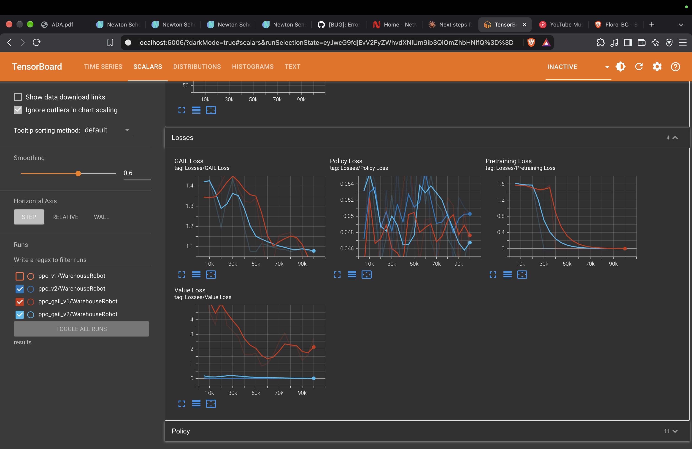
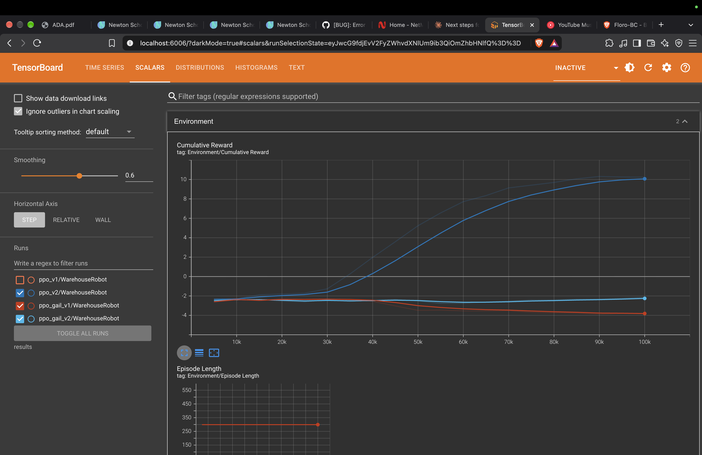

# WareWars: AI Warehouse Robot (Unity ML-Agents)

A robot in a simulated Unity warehouse that learns on its own to pick up packages and deliver them to a drop zone. Built by **Divyansha Singh** for my SWAYAM course project (Unity, C# and reinforcement learning).


> Demo video: `docs/demo.mov` (trained PPO robot delivering packages, no human control)

## What it does
- Warehouse built in Unity with C# scripts for movement, pickup and scoring
- The robot is an ML-Agents agent trained with **PPO** (Proximal Policy Optimization)
- I also tested whether **imitation learning** (behavioral cloning + GAIL) speeds up training

## Results

| Run | Method | Final mean reward |
|---|---|---|
| Untrained | Random behavior | about -2.3 |
| `ppo_v2` | PPO from scratch | **about +10.2** |
| `ppo_gail_v1` | PPO + GAIL + behavioral cloning | about -3.85 |
| `ppo_gail_v2` | PPO + GAIL + behavioral cloning (retuned) | about -2.15 |

All runs trained for 100,000 steps. PPO from scratch took about 7.5 minutes.



PPO crossed zero reward at around 35k steps, which is where the robot found the pick-and-deliver loop. Reward then climbed to about 10 and the variance dropped, so the behavior became consistent.

## Imitation learning: what I found
I recorded my own demonstration (about 900 steps, 3 episodes) and added behavioral cloning and GAIL.



- The imitation losses went down, so the agent did learn to copy the demo.
- But it never learned to deliver. Reward stayed around -2 to -4.
- **Hypothesis:** the demo was too small (about 900 steps). Imitation gave a weak signal that got in the way of PPO finding the delivery loop by itself. A longer demo (5,000+ steps) is the next thing to try.

## What failed and how I fixed it
- **Torch version mismatch / crash on startup:** pinned a compatible torch version for ML-Agents.
- **StrictVersion error:** fixed by using compatible package versions.
- **UnityTimeOutException:** Unity was not sending data to the trainer. Fixed by turning on Run In Background and keeping Unity in front after pressing Play.
- **Imitation runs failed to learn:** see the section above.

## Tech stack
Unity, C#, ML-Agents, PyTorch, TensorBoard.

## Repo structure
- `Assets/` Unity scenes, scripts, demonstrations
- `config/` training configs (`warehouse_ppo.yaml`, `warehouse_ppo_gail.yaml`, `warehouse_ppo_gail2.yaml`)
- `models/ppo_v2_baseline.onnx` the trained model
- `docs/` demo video and result charts

## How to train
```bash
conda activate mlagents
mlagents-learn config/warehouse_ppo.yaml --run-id=ppo_v2
```
Press Play in Unity when the trainer says it is listening.

## Q-learning baseline (course concept)
Before using PPO, I built a small tabular Q-learning agent on a 5x5 grid warehouse (pick up a package, then deliver it to the drop zone). Code: `q_learning/q_learning_warehouse.py`.

| Episodes | Average reward |
|---|---|
| First 100 | -5.18 |
| Last 100 | **+9.94** |

Q-learning solves the small grid with a lookup table. In the full Unity warehouse the state space is too big for a table, so I used PPO, a neural-network method. I also tested imitation learning on top. So the project compares **Q-learning, then PPO, then imitation learning**.
